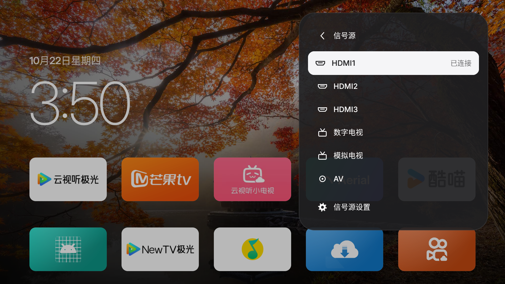
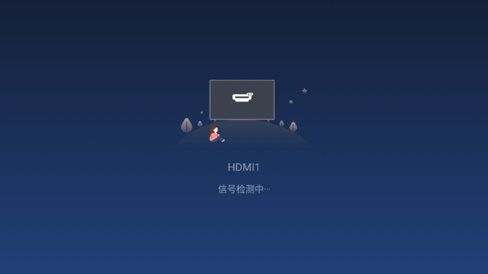

# Konka KKTV U86V9 / Android TV 9652

- Retail model reported by the owner: KKTV U86V9. Runtime model: `Konka Android TV 9652`.
- Android 9 / SDK 28, MT9652, armeabi-v7a, `ro.config.low_ram=true`; observed on 2026-10-22.
- Official Aerial 1.22 standard (versionCode 24) was used for HOME, reboot, weather and screensaver
  observations. The input adapter was verified separately in the isolated release build below.

## Initial launch and hidden ADB entry

- The owner reported that the built-in file manager refused APK installation. After installation
  through another route, the installer showed "无法运行此应用" on Open, and the stock My Apps list
  did not show Aerial. The successful initial sideload route was not recorded precisely enough
  to recommend as a reproducible installation method.
- Activity Launcher could explicitly start `app.orchard.tv.MainActivity`, and Aerial then worked.
  Activity Launcher 2.4.1 needed a USB mouse on this TV. This proves the installed app could run;
  it does not establish the root cause of the stock launcher's missing entry or installer error.
- The normal settings UI did not expose an Android version/developer/accessibility entry to the
  owner, and DevEnabler's first "Open developer options" action failed on this firmware.
- Activity Launcher exposed `com.konka.kkfactory.FactoryHome` in package `com.konka.kkfactory`.
  Open it, then select **软件调试功能 -> 打开adbd**. This enabled the network ADB connection used
  for the subsequent checks. **adb root权限** remained off. Do not change panel, calibration,
  factory-reset, upgrade or other factory parameters as part of this procedure.
- These are observations on this firmware, not a universal entry sequence for Konka TVs.

## HOME and one full reboot

- The original HOME resolver was `com.konka.livelauncher/.TrueLauncher`. Setting Aerial as HOME
  returned success but the resolver still named TrueLauncher; that alone did not establish
  successful HOME takeover.
- After ADB permissions and Aerial's existing HomeGuardService were enabled, one bound guard
  service was observed. The owner verified the physical remote HOME key returned to Aerial.
- One owner-approved full reboot was performed. The boot ID changed, Android reported boot
  complete, and Aerial was in front before any HOME event or manual app launch. The owner also
  confirmed that Aerial appeared automatically. Standby/wake and long-term reliability were not
  tested in this sequence.
- No stock launcher/system app was disabled or uninstalled, and adbd root was not enabled.
- This MT9652 / Aerial 1.22 result must not be used to close #88, which concerns a different
  Konka V560 / Hisilicon model on Aerial 1.18.

## Weather workaround

The original app had no selected/guessed place and no weather. Manually selecting a city through
Aerial's existing phone configuration page set `chosen=true` and produced a weather reading and
visible city/temperature on the TV. No weather code was changed. A PC-side request to the IP
geolocation service returned HTTP 429 during diagnosis, but there was no matching TV-side trace;
do not present that response as the confirmed cause of this TV's original failure, or as a
Konka location-permission defect. This is a tested workaround, not a root-cause fix.

## Native inputs

- `TvInputManager` and `dumpsys tv_input` expose no inputs. The native input picker lists six.
- Native player: exported `com.konka.tvsettings/com.konka.tvsettings.RootActivity`.
- Read the boot-classpath `com.konka.android.tv.KKCommonManager` through reflection, without
  redistributing vendor classes. `getInstance(Context)` takes the application context.
- `getTVInputSourceList()` returns only the ports configured for this TV;
  `getAvaliableInputSourceList()` returns plugged-in ports (the spelling is part of the SDK).
  `getInputSourceName(EN_KK_INPUT_SOURCE)` supplies the native display labels.

| Native label | Enum name | Ordinal passed as integer extra `source` |
| --- | --- | --- |
| 数字电视 | DTMB | 4 |
| 模拟电视 | ATV | 0 |
| AV | AV | 10 |
| HDMI1 | HDMI | 35 |
| HDMI2 | HDMI2 | 36 |
| HDMI3 | HDMI3 | 37 |

The SDK defines HDMI4 too, but it is absent from this TV's actual list. Do not infer ports from
all enum constants or confuse enum ordinals with chipset-specific hardware/source IDs.

## Validation boundary

- The native picker, a shell diagnostic, and an ordinary third-party app agreed on the six
  labels, ordinals and connection status. HDMI1 was plugged in; HDMI2/3 and AV were not.
- A shell launch of RootActivity with `source=36` selected HDMI2; the native SDK confirmed both
  the active and saved source. Signal playback itself was not validated on that empty port.
- `KonkaSources` feeds the existing Aerial control-center input page and pinning path. It adds
  no separate input-selection UI and needs no additional Android permissions.
- Standard release and an isolated guard-flavor release build compiled. The isolated Aerial build
  (`app.orchard.tv.konkapreview`, label `Aerial 康佳测试`) was installed alongside the official
  app. The test-only manifest omitted HOME handling, guard/boot/revival services, and Dream
  registration so the owner's official launcher and screensaver remained selected.
- On that build, the existing top-right control center -> inputs page displayed all six native
  sources, with only HDMI1 marked connected. Remote-direction/confirm key events selected HDMI2
  and then HDMI1 through that page. Each opened the native RootActivity; the native SDK confirmed
  both active and saved sources matched the selection. The native player remained in front
  until the next explicit navigation. The initial saved source, HDMI1, was restored.
- Pressing HOME still returned to the official Aerial. Its Beijing weather and existing home
  layout remained visible. Before/after snapshots agreed on the HOME resolver, accessibility
  service list, Dream component, native screen-protection setting and official app version.
- Playback, CEC device names, live cable hot-plug refresh, other Konka models, and patched-build
  boot/standby behavior were not validated. An HDMI connection does not establish playable video.
- Official installs reject a differently signed local APK. Do not uninstall the owner's copy
  or clear its data merely to test this patch; the tested parallel app has separate app data.

The existing Aerial input page in the isolated test build:

After selecting HDMI1 in that page, Konka's native player opened. The signal-detection screen
below establishes the route, not successful video playback:

## Native screensaver

This TV also has its own Settings → General → Screen protection switch, independent of Android
Dream selection. Turning that switch off changes `global/ScreenSaver` from 1 to 0 while leaving
`secure/screensaver_enabled=1` and AerialDream selected. A 183-second video-screensaver observation
showed no native takeover after that change. This is a manual system setting, not changed by
the input adapter.

## Brightness: unresolved

- Brightness adjustment did not visibly change this TV's panel in the owner's observation.
- An experimental backend called the boot-classpath `KKPictureManager.getBacklight()` /
  `setBacklight(short)` used by Konka's own backlight slider. In the isolated Aerial build,
  changing the vendor value from 100 to 40 changed its readback, but the owner saw no dimming.
- The same comparison in **Konka's native settings** changed the backlight slider from 100 to
  39; the owner again saw no dimming. Thus this observation is not specific to Aerial's UI.
- Android `screen_brightness` stayed 47 with manual mode 0. Vendor image brightness stayed 50
  and picture mode stayed `SOFT` (the native UI labels it 自然). Neither image brightness nor
  a software overlay was substituted for panel backlight.
- The SDK reported no light sensor support or enabled light sensor. A separate comparison
  temporarily disabled dynamic backlight, kept the panel enabled and set backlight to 40.
  The lower `PictureImpl.setBacklight(40, true, true)` returned 0. The owner later answered
  "unable to judge" for this separate comparison, after the settings had already been restored.
  It remains inconclusive and must not be counted as either a visible improvement or no effect.
- Restored and read back: backlight 100, dynamic backlight enabled, panel enabled. Android
  brightness/mode and vendor image brightness/picture mode also matched their initial values.
- The exact firmware/driver cause remains unknown. An accepted SDK call and saved-value
  readback do not establish a working backlight adjustment. The experimental brightness
  backend is excluded from this input patch; no brightness fix is claimed.

No factory calibration, PWM parameters, firmware, root setting or system applications were
changed during these comparisons. Further TV testing was stopped at the owner's request.
